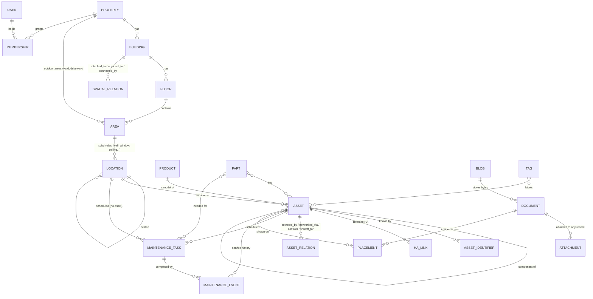

# Home IoT Maintenance App: Data Model, Storage, and Backup Design

Status: v1.3 (2026-11-06). Maintainer role, critical items, and per-role room restrictions added (section 2.3.1). Open questions answered by Shane (section 6); multiple buildings per property added (section 2.3, 2.3.2). Source spec: `HomeIOTManagementApp.md`.
Assumes the stack from the master plan ([HomeIOT-Master-Plan.md](HomeIOT-Master-Plan.md)): Python + FastAPI, SQLAlchemy 2.x + Alembic, SQLite by default, PostgreSQL optional.

---

## 1. Summary of recommendations

| Area | Recommendation | License check |
| :-- | :-- | :-- |
| Primary database | **SQLite 3 (WAL mode)**, single file. One household is thousands of rows, not millions; zero setup, works offline on a laptop, trivially backed up. | Public domain |
| Optional database | **PostgreSQL 15+** for cloud / multi-instance deployments, behind the same SQLAlchemy models. | PostgreSQL License (permissive) |
| ORM / migrations | SQLAlchemy 2.x + Alembic (batch mode for SQLite `ALTER`s). | MIT / MIT |
| DB drivers | `aiosqlite` for SQLite, **`asyncpg`** for Postgres (psycopg is LGPL, so avoid). | MIT / Apache-2.0 |
| IDs | **UUIDv7** (RFC 9562, time-ordered) for every row, generated by the app. Stored as 36-char text for portability and readability in exports. Python 3.14 has `uuid.uuid7()`; otherwise `uuid6` package (MIT). | |
| File storage | **Content-addressed blob store** (SHA-256 keyed) behind a small `BlobStore` interface. Default: local filesystem. Optional: any S3-compatible service via `boto3`/`aioboto3`. | Apache-2.0 |
| Image processing | Pillow for thumbnails and EXIF/GPS stripping. pdf.js in the browser to render manuals. **Avoid** `sharp`/libvips (LGPL), MuPDF (AGPL), Poppler (GPL), MinIO and Garage (AGPL) as bundled dependencies. | HPND / Apache-2.0 |
| Recurrence | `python-dateutil` `rrule` (RFC 5545) for calendar-fixed schedules, plus a simple "N days/months after last completion" mode. | Apache-2.0 / BSD |
| Search | SQLite FTS5 virtual table (Postgres: `tsvector` + `pg_trgm`), wrapped in one `SearchIndex` service. | built in |
| Backup format | One self-describing **`.hiotbak` zip**: manifest + DB snapshot + engine-neutral JSON export + blobs. Same format for full backups, partial exports, and "house handover" packages. | stdlib `zipfile` |
| Off-site / continuous | Documented recipes, not built in for v1: **restic** (BSD-2) for off-site copies of the backup folder, **Litestream** (Apache-2.0) for continuous SQLite replication on cloud hosts. | |
| Calendar export | Read-only **iCalendar (.ics)** feed of upcoming maintenance via `icalendar` (BSD-2). | |

---

## 2. Data model

### 2.1 Conventions (all tables)

- `id` UUIDv7, primary key, generated by the app (never by the DB) so records can be created offline and merged later.
- `created_at`, `updated_at` (UTC timestamps), `created_by`, `updated_by` (user id).
- `deleted_at` soft delete for user-facing entities. Lets restore/merge reason about deletions, and gives an "undo" for accidental deletes. A purge job hard-deletes after N days.
- `extra` JSON column on major entities for user-defined fields (works in SQLite JSON1 and Postgres JSONB). Promote to real columns once a field proves common.
- Dates that are "calendar days" (install date, due date) are stored as `DATE`, not timestamps, and interpreted in the property's timezone.
- Naming follows Home Assistant where a concept overlaps: `floor`, `area`, `device`, `entity`, `manufacturer`, `model`, `model_id`, `sw_version`, `hw_version`, `serial_number`, `connections`, `via_device`.

### 2.2 Entity overview



### 2.3 Tables

**Property and space**

| Table | Key columns | Notes |
| :-- | :-- | :-- |
| `property` | name, address, timezone, default_currency | Supports more than one home (rental, cabin) at low cost. Every top-level record carries `property_id`. |
| `building` | property_id, name, kind (house, garage, shed, barn, workshop, pool_house, cottage, other), is_primary, year_built, notes, site_x, site_y, rotation_deg, footprint (GeoJSON polygon, nullable) | A structure on the property. Every property gets one default building ("House") so the simple case needs no extra setup. The `site_*` and `footprint` columns are nullable placeholders for the future outdoor map, in site coordinates (section 2.3.2). |
| `floor` | building_id, name, level (int), ha_floor_id | Mirrors HA floors. HA has no building concept, so on import the import preview asks which building each HA floor belongs to, defaulting to the primary building. |
| `spatial_relation` | property_id, from_type (building, area), from_id, to_type, to_id, kind (attached_to, adjacent_to, detached_from, connected_by), via (breezeway, underground_conduit, path, driveway, free text), distance_m, bearing_deg, notes | Basic relationships between buildings and outdoor areas: "garage attached to house, east side", "shed 25 m north of house, power via buried conduit". Physical utility runs between buildings (a subpanel in the garage fed from the house panel) stay in `asset_relation`. |
| `area` | property_id, building_id (nullable), floor_id (nullable), name, kind (room, hallway, attic, crawlspace, basement, yard, garden, driveway, patio, pool, other_outdoor), site_x, site_y, footprint (nullable), ha_area_id, is_critical (bool, default false) | HA calls rooms "areas"; we keep that name in code, show "Room" in the UI. Indoor areas have a `floor_id` (and its building); outdoor areas such as the yard or driveway have no building or floor and hang off the property directly, ready for landscape lighting and irrigation on the outdoor map. A check constraint enforces: floor set implies building set and matching. |
| `location` | area_id, parent_location_id, name, kind (wall, window, door, ceiling, floor, cabinet, closet, exterior_wall), orientation (N/E/S/W or free text), position_note | The "north wall, left of the window" level. Self-nesting allows "cabinet under sink > back panel". |

**Assets (devices, appliances, equipment)**

| Table | Key columns | Notes |
| :-- | :-- | :-- |
| `product` | manufacturer, model, model_id, category, manual_url, support_url, extra | Optional shared catalog: two identical smoke detectors share one product and one manual. |
| `asset` | property_id, product_id, location_id, parent_asset_id, name, category, status (active, spare, retired, disposed), install_date, purchase_date, purchase_price, vendor, warranty_expires, sw_version, hw_version, is_critical (bool, default false), notes (markdown), extra | `category` is a controlled list (appliance, hvac, plumbing, electrical, lighting, network, sensor, security, structural, other) plus tags for anything finer. `parent_asset_id` models components: furnace > blower motor, panel > breaker. |
| `asset_identifier` | asset_id, kind, value (normalized), source | One row per ID: `serial`, `mac`, `zigbee_ieee`, `zwave_dsk`, `thread_ext_addr`, `ble_addr`, `upc`, `asset_tag`, `ha_device_id`, `ha_entity_id`, `other`. Unique on (property, kind, value) for kinds that must be unique. This is what makes HA import dedupe and "find by MAC" work. |
| `asset_relation` | from_asset_id, to_asset_id, kind, detail | A small graph that answers "what powers this, what network is it on, what controls it, which valve shuts it off". Kinds: `powered_by` (circuit/outlet/battery), `networked_via` (AP, hub, bridge; maps to HA `via_device`), `controls`, `supplied_by` (water/gas line), `shutoff_for`, `drains_to`. Future breaker boxes, circuits, conduits, pipes, and shutoff valves are just assets with these categories, so no new tables are needed later. |
| `ha_link` | asset_id, ha_instance_id, ha_device_id, ha_entity_ids (JSON), last_seen_at, last_snapshot (JSON of registry fields) | Keeps HA context without depending on it. The snapshot lets the troubleshoot view show "last known" HA state when HA is offline. |
| `ha_instance` | name, base_url, token_ref | Token stored outside the DB (env var or secrets file), never in backups unless the user opts in. |
| `tag`, `asset_tag` | name, color | Free labels ("outdoor", "winterize", "smart"). |
| `part` | name, manufacturer, part_number, supplier_url, typical_cost, quantity_on_hand, extra | Filters, batteries, bulbs. `part_fits_asset` and `task_part` join tables. |

**Maintenance and calendar**

| Table | Key columns | Notes |
| :-- | :-- | :-- |
| `maintenance_task` | property_id, asset_id (nullable), location_id (nullable), title, procedure (markdown), schedule_kind, interval_value, interval_unit (day/week/month/year), rrule, anchor_date, next_due, lead_days, season_window, active, assignee_role | Two scheduling modes. **`after_completion`**: "change fridge filter every 6 months" counts from the last time you actually did it. **`fixed_calendar`**: RFC 5545 RRULE such as `FREQ=YEARLY;BYMONTH=11;BYMONTHDAY=1` for "shut off the outdoor hose valve each November". `location_id` lets a task live on a place or valve rather than a device. |
| `maintenance_event` | task_id (nullable for ad-hoc repairs), asset_id, performed_on, performed_by, outcome (done, skipped, partial, failed), cost, currency, vendor, duration_min, notes, readings (JSON, e.g. battery voltage) | Service history. Inserting a `done` event recomputes `task.next_due` in the same transaction. `skipped` advances the schedule without counting as done. |
| `event_part` | event_id, part_id, quantity | Parts used; decrements stock if tracked. |
| `reminder_state` | task_id, user_id, snoozed_until, last_notified_at | Per-user snooze and notification bookkeeping; derived, safe to drop. |

`next_due` is stored (denormalized) so dashboards and the .ics feed are a simple indexed query, and is always recomputable from the task rule plus its latest event.

**Documents, photos, and floor plans**

| Table | Key columns | Notes |
| :-- | :-- | :-- |
| `blob` | sha256 (PK), size, mime_type, created_at | Physical bytes, deduplicated. One row per unique file. |
| `document` | property_id, blob_sha256 (nullable), url (nullable), kind (manual, photo, label_photo, receipt, warranty, invoice, procedure, floor_plan, wall_photo, other), title, original_filename, captured_at, sensitivity (guest, resident, admin) | Either a stored file or an external link (manual URL). `sensitivity` drives what Guests can see (receipts and invoices default to `resident`). |
| `attachment` | document_id, target_type, target_id, role, sort | Polymorphic link so one manual can attach to a product, three assets, and a task. `target_type` is a fixed enum checked in code. |
| `canvas` | document_id, scope_type (property, building, floor, area), scope_id, kind (site_plan, floor_plan, wall_photo, panel_photo), scale_px_per_m (optional) | Any image that devices can be pinned onto. |
| `placement` | canvas_id, asset_id, x, y (normalized 0.0 to 1.0), label, shape (point, rect, polygon JSON) | "Which smart switch is which" on a wall photo, or device pins on a floor plan. Normalized coordinates survive image resizing. |

**Users and permissions**

| Table | Key columns | Notes |
| :-- | :-- | :-- |
| `user` | email, display_name, password_hash (argon2 via `argon2-cffi`, MIT), is_active, last_login_at | Local accounts work offline. OIDC can be added later. |
| `membership` | user_id, property_id, role (admin, maintainer, resident, guest), expires_at | Roles are per property. Any non-admin membership can have an expiry (house sitter, contractor). |
| `access_rule` | property_id, scope_type (building, area, tag, asset), scope_id, subject_type (role, membership), subject (role name or membership_id), level (hidden, view, control, manage), expires_at, note | One table for every room or device exception, for any non-admin role or one specific person. Can lower access (teenager has no control of the master bedroom) or raise it (house sitter may control the thermostat). See section 2.3.1. |
| `api_token` | user_id, name, token_hash, scopes, expires_at | For the read-only REST API and future HA plugin. |
| `audit_log` | at, user_id, action, target_type, target_id, diff (JSON) | Who changed what. Excluded from partial exports, included in full backups. |

### 2.3.1 Roles, critical items, and room restrictions (confirmed by Shane)

**Four roles, per property.** Shane's example for Maintainer: the teenage geek who adds the new game console and TV and wires them into Home Assistant, but whose parents don't let them touch the master bedroom controls.

| Role | Records (assets, rooms, docs) | Maintenance log | Device control | HA and integrations | Users, backup, restore |
| :-- | :-- | :-- | :-- | :-- | :-- |
| **Admin** | Everything | Yes | Everything | Everything | Yes |
| **Maintainer** | Add, edit, delete, except critical items | Yes | Yes, except where restricted | Import devices, link and configure HA items and integrations, except critical items | No; cannot change admins or roles |
| **Resident** | Add photos and documents; edit notes | Yes (log work done, costs) | Yes, except where restricted | No | No |
| **Guest** | Read-only, sensitive fields hidden | No | Only where allowed | No | No |

**Access levels** form one ladder: `hidden` < `view` < `control` (operate the device) < `manage` (edit the record, change its HA link or integration settings, delete it). Each role has a default ceiling: Maintainer `manage`, Resident `control`, Guest `view`. Admin is never limited by rules.

**Room and device restrictions** are `access_rule` rows. Examples:

| Scope | Subject | Level | Effect |
| :-- | :-- | :-- | :-- |
| area: Master bedroom | role: maintainer | view | The teenager sees the bedroom's devices but cannot operate or reconfigure them. |
| area: Master bedroom | role: guest | view | Guests see bedroom lights but cannot switch them. |
| area: Living room | role: guest | control | Guests can switch living room lights. |
| area: Server closet | role: guest | hidden | Guests don't see it at all. |
| asset: Alarm panel | role: guest | view | Overrides the living room rule for one device. |
| asset: Thermostat | membership: house sitter | control, expires 2026-12-01 | Extra right for one person, time-limited. |

Resolution, computed by one `AccessPolicy` service used by every endpoint (UI, REST, search, floor-plan pins, exports, the HA control proxy): start from the role's default ceiling; then apply the most specific matching rule, in order asset > tag > area > building (child assets inherit from their parent asset); a rule for a specific membership beats a role rule at the same scope; expired rules are ignored. Rules may raise or lower access, but never above `control` for guests or residents.

**Critical items.** `is_critical` on an asset or area (inherited by child assets and everything in a critical area) means only Admins can `manage` it: edit or delete the record, change its HA link, or reconfigure its integration. Other roles keep whatever view and control the rules give them; to also block control, add a rule. Suggested defaults the admin is prompted to mark during setup: alarm panel, smart locks, garage door openers, main water shutoff, gas valves, electrical panels, HVAC thermostats, the network router, and the Home Assistant host itself. Changes to `is_critical` and to `access_rule` are Admin-only and always written to `audit_log`.

**Always hidden from guests**, even where they can see a device: costs and purchase prices, receipts and invoices (document `sensitivity`), serial numbers, network identifiers (MAC, IP, Zigbee/Z-Wave IDs), HA entity internals.

**Enforcement and its limit.** All control and configuration from our app goes through our backend, which checks `AccessPolicy` and then calls Home Assistant with the server-side token; guests, residents, and maintainers never receive that token. Guests are further limited to simple services (`turn_on`, `turn_off`, `toggle`, brightness, thermostat setpoint within limits); lock, alarm, and configuration services need an explicit asset rule. **Caveat:** these restrictions only cover actions taken through our app and its future HA plugin. Home Assistant itself has no per-room or per-device user permissions, so a maintainer who also has their own HA login (especially an HA admin login) can bypass them there. The setup guide should recommend that only Admins hold HA accounts, or that maintainers get a non-admin HA user and accept this limit.

### 2.3.2 Buildings and the future outdoor map

- **v1 scope:** buildings as a level above floors (Property > Building > Floor > Area > Location), outdoor areas at property level, and `spatial_relation` rows entered as simple text-like facts. The UI shows a building picker and groups rooms by building; search and filters accept building ("all devices in the garage").
- **Site coordinates (future):** one local coordinate system per property, in meters, origin at a point the user picks (for example the front-left house corner), x east, y north. `building.site_x/site_y/rotation_deg/footprint` and `area.site_x/site_y/footprint` live in that system, so a site-plan canvas (an aerial photo or a hand-drawn sketch) can place buildings and outdoor assets such as landscape lights and irrigation valves using the existing `placement` table.
- **No real-world location stored by default.** An optional `property.geo_anchor` (lat/lon of the origin) can be added later for satellite imagery, but it is off by default and excluded from handover exports unless chosen, for privacy.
- Geometry stays as plain GeoJSON in a JSON column; no PostGIS or SpatiaLite dependency (SpatiaLite is MPL/GPL/LGPL tri-licensed, so avoid it in core anyway). Simple math (distance, point-in-polygon) can use Shapely (BSD-3) if needed.
- Backup and export need no changes beyond the new tables; partial-export closure now walks area > floor > building > property.

### 2.4 Home Assistant import and matching

HA device registry entries provide `id`, `name`, `manufacturer`, `model`, `model_id`, `serial_number`, `sw_version`, `hw_version`, `area_id`, `via_device_id`, `connections` (e.g. `("mac", "aa:bb:...")`, `("zigbee", "...")`) and `identifiers` (`(domain, id)` pairs). Import maps each to `asset_identifier` rows and matches in this order, showing the result in the preview screen:

1. Exact `ha_device_id` already linked: update, never duplicate.
2. Any `connections` value equals an existing `mac` / `zigbee_ieee` / etc. identifier: propose link.
3. `serial_number` + `manufacturer` match: propose link.
4. Fuzzy name + model in the same area: show as "possible match", user decides.
5. Otherwise: propose new asset; HA `area_id` maps to our `area.ha_area_id`, `via_device_id` becomes a `networked_via` relation.

### 2.5 Indexes and search

- Index every foreign key, `asset(property_id, category)`, `maintenance_task(property_id, next_due) WHERE active`, unique `asset_identifier(property_id, kind, value)`.
- One FTS5 table (`search_fts`) over asset name, notes, product manufacturer/model, identifiers, tags, area and location names, and document titles. Kept in sync from the service layer (not triggers) so the Postgres implementation can differ.
- Optional later: extract text from PDF manuals with `pypdf` (BSD) into the index so you can search inside manuals.

---

## 3. File and document storage

### 3.1 Layout

```
<data_dir>/
  app.sqlite              # database (WAL mode)
  blobs/ab/cd/abcd1234...  # content-addressed originals, sha256, sharded 2 levels
  cache/thumbs/...         # derived thumbnails and previews (regenerable, never backed up)
  backups/                 # local .hiotbak archives
  config.toml              # settings; secrets come from env or a separate secrets file
```

A single `data_dir` setting (default `~/.local/share/<app>/` on a laptop, `/data` in Docker) holds everything, so "copy one folder" is also a valid manual backup when the app is stopped.

### 3.2 `BlobStore` interface

```python
class BlobStore(Protocol):
    async def put(self, stream: AsyncIterator[bytes], mime: str) -> BlobRef: ...  # hashes while streaming, returns sha256
    async def open(self, sha256: str) -> AsyncIterator[bytes]: ...
    async def exists(self, sha256: str) -> bool: ...
    async def delete(self, sha256: str) -> None: ...
    async def iter_all(self) -> AsyncIterator[str]: ...
```

- `LocalFsBlobStore` (default): write to a temp file, fsync, atomic rename into place.
- `S3BlobStore` (optional): any S3-compatible endpoint (AWS S3, Backblaze B2, Cloudflare R2, or a self-hosted SeaweedFS which is Apache-2.0). We do not bundle or require MinIO/Garage because of AGPL.
- Content addressing gives free dedupe (the same manual PDF attached to 6 smoke detectors is stored once), integrity checks (re-hash and compare), and simple backup diffing.
- Unreferenced blobs are removed by a mark-and-sweep job with a 7-day grace period, so an in-progress upload or a recent undo never loses data.

### 3.3 Upload handling and security

- Size limit per file (default 50 MB, configurable); allowlist of types: JPEG, PNG, WebP, PDF, plain text, Markdown.
- **HEIC (iPhone photos) is not in the core app.** The usual decoder (libheif, via `pillow-heif`) is LGPL. Per Shane: never ship LGPL code in the core; it may only be installed as an optional extension that a user explicitly chooses to add (for example `pip install <app>[heic]` plus a settings toggle). Without it, the upload screen explains how to export JPEG from iPhone (Settings > Camera > Formats > Most Compatible), and the browser can also convert HEIC client-side only if a permissively licensed decoder is found later.
- Detect type from content (magic bytes), not filename. SVG is not accepted as an image (script risk).
- **Strip EXIF GPS** and other metadata from photos by default (a photo of your breaker panel should not carry your home coordinates into an export). Keep orientation; keep `captured_at` in the `document` row.
- Files are only served through an authorized endpoint (`/api/v1/documents/{id}/content`) that checks role and `sensitivity`, with `Content-Disposition` and `X-Content-Type-Options: nosniff`. Never served as a public static folder.
- Thumbnails (e.g. 256 px and 1024 px WebP) are generated lazily into `cache/` and can be deleted at any time.
- "Find the manual" helper: store the URL immediately; optionally offer "download a local copy" so manuals survive the manufacturer taking the page down.

---

## 4. Backup, restore, and export

### 4.1 Backup archive format (`.hiotbak`, a zip)

```
manifest.json
db/app.sqlite            # consistent snapshot (SQLite only), fastest full restore
data/<table>.jsonl       # engine-neutral canonical export, one JSON object per row
blobs/<sha256>           # every referenced blob (originals only)
```

`manifest.json` contains: `format_version`, `app_version`, `schema_version` (Alembic revision), `created_at`, `instance_id`, `kind` (`full`, `partial`, `handover`), `property_ids`, row counts per table, SHA-256 of every file in the archive, and flags such as `includes_audit_log`, `includes_secrets` (false by default), `encrypted`.

Why both a DB snapshot and JSONL: the snapshot restores in seconds with perfect fidelity; the JSONL is human-readable, diffable, documented by a published JSON Schema, works across SQLite and Postgres, and is the long-term escape hatch if the app is abandoned. JSONL is the source of truth for imports, merges, and cross-engine restores.

How the snapshot is taken safely while the app runs: SQLite `VACUUM INTO 'tmp.sqlite'` (or the online backup API), then `PRAGMA integrity_check` on the copy. On Postgres the archive carries only JSONL (plus an optional `pg_dump --format=custom` file if the admin enables it).

### 4.2 Backup features

- **Manual backup**: "Download backup" button (Admin only) and `domus backup create` CLI.
- **Scheduled backups**: built-in scheduler (APScheduler, MIT) writes to `backups/` daily by default.
- **Retention**: keep 7 daily, 4 weekly, 12 monthly by default; configurable.
- **Optional encryption**: passphrase-encrypted archive using the `age` format via `pyrage` (MIT/Apache-2.0), so backups can be safely copied to cloud storage and decrypted with the standard `age` CLI. Passphrase never stored by the app.
- **Off-site copies**: optional `S3BlobStore`-style upload target for archives, plus documented recipes for restic and Litestream for users who already run them.
- **Verify**: `domus backup verify <file>` and a UI button check every hash, open the snapshot, run `integrity_check`, and confirm every referenced blob is present. A scheduled weekly verify of the newest backup catches silent corruption.
- **Health indicator**: the admin dashboard shows "last successful backup N days ago" and warns after a configurable threshold.

### 4.3 Restore

- **Full restore (replace)**: Admin only, works with Home Assistant offline. Steps: verify archive, take an automatic safety backup of the current state, restore into a new temp database, run Alembic migrations forward if the archive is older, copy blobs, then atomically swap the database file and restart the app's DB pool. If anything fails, the current data is untouched.
- **Merge import**: load JSONL rows and upsert by UUID. Rules: newer `updated_at` wins by default; conflicts are listed in a preview for the user to accept per record. Soft-deleted rows propagate deletions. This is the same code path used by partial exports and HA-free transfers between installs.
- **Version rules**: restoring an archive from an older app version is always supported (migrate forward). Restoring a newer archive into an older app is refused with a clear message.
- **CLI first**: `domus restore <file> [--merge] [--dry-run]` exists so recovery works even if the web UI is broken.

### 4.4 Export and transfer

| Export | Contents | Use |
| :-- | :-- | :-- |
| Full backup | Everything above | Disaster recovery, moving to a new machine or to cloud hosting. |
| Partial export | User-selected assets, rooms, or tags, plus the closure of what they need: locations and their parent areas, floors, and buildings, products, documents and blobs, tasks, events, parts, relations. | Moving one system's records, sharing with a contractor. Imports via merge. |
| **House handover** | Like partial, but excludes costs, receipts, purchase prices, audit log, users, HA links, and network identifiers by default. | Selling or renting the home: give the next owner the equipment list, manuals, and maintenance schedule. |
| CSV | One CSV per main table (assets, tasks, events, parts) | Spreadsheets and quick reporting. Export only, not a restore format. |
| iCalendar | Upcoming `maintenance_task` due dates as VTODO/VEVENT with alarms | Subscribe from phone or desktop calendar; token-protected read-only URL. |
| JSON Schema | Published schema for the JSONL format | Lets other tools read and write records. |

---

## 5. Postgres support: scope for v1

Keep the schema portable from day one (SQLAlchemy types only, UUIDs as text, JSON via SQLAlchemy `JSON`, FTS behind `SearchIndex`), and run the test suite against both engines in CI. Recommendation: ship v1 officially on SQLite, mark Postgres as "supported, experimental" until the cloud deployment story is built. Moving between them is just backup on one, restore (JSONL path) on the other.

---

## 6. Decisions (answered by Shane, 2026-11-06)

1. **Multiple properties per install: yes.** The schema already carries `property_id`; the UI needs a property switcher.
2. **PostgreSQL: experimental in v1.** SQLite is the official engine; Postgres is tested in CI but labelled experimental.
3. **Backup encryption: yes, optional.** Off by default for local backups, offered (and recommended) when an off-site or cloud target is configured.
4. **HEIC: optional only.** Project-wide rule: never use LGPL (or any FSF-licensed) code in the core application, only as an extension a user explicitly asks to install. CI should run a license check (e.g. `pip-licenses --fail-on` with a list of GPL/LGPL/AGPL identifiers) on the core dependency set.
5. **Guests: limited both in what they see and what they control**, per room and per device. Designed in section 2.3.1.
6. **Maintainer role added** (between Admin and Resident): can add items and configure most devices and HA integrations, but cannot change admins or roles and cannot manage items marked critical; rooms can be restricted per role or per person. Designed in section 2.3.1.

---

## 7. First implementation steps (data layer)

1. Create SQLAlchemy models and the initial Alembic migration for: property, building, spatial_relation, floor, area, location, product, asset, asset_identifier, asset_relation, tag, document, blob, attachment, maintenance_task, maintenance_event, user, membership, access_rule, audit_log. Add the core-dependency license check to CI at the same time. Enable SQLite WAL, foreign keys, and busy timeout on connect.
2. Implement `LocalFsBlobStore` with streaming SHA-256, atomic writes, and an upload endpoint with type sniffing and EXIF stripping.
3. Implement the scheduling service: `compute_next_due(task, last_event)` for both modes, with pytest parametrized tests covering month-end and DST edges. (Hypothesis is not used: it is MPL-2.0, which is ASF Category B, and AGENTS.md requires Category A for test tools too.)
4. Implement JSONL export and import (full and partial with closure), then the `.hiotbak` writer, reader, and verifier on top.
5. Add `domus backup create|verify` and `domus restore [--merge] [--dry-run]` CLI commands, then the scheduled backup job with retention.
6. Implement the `AccessPolicy` service (four roles, access levels, rules, critical items) with a table-driven test suite covering role defaults, area vs asset vs tag precedence, membership vs role rules, expiry, and critical inheritance, before any endpoint ships.
7. Add the FTS5 search index and read-only REST endpoints over the same service layer.
8. CI: run model, migration, and backup round-trip tests (backup, wipe, restore, compare row counts and hashes) on SQLite and Postgres.
